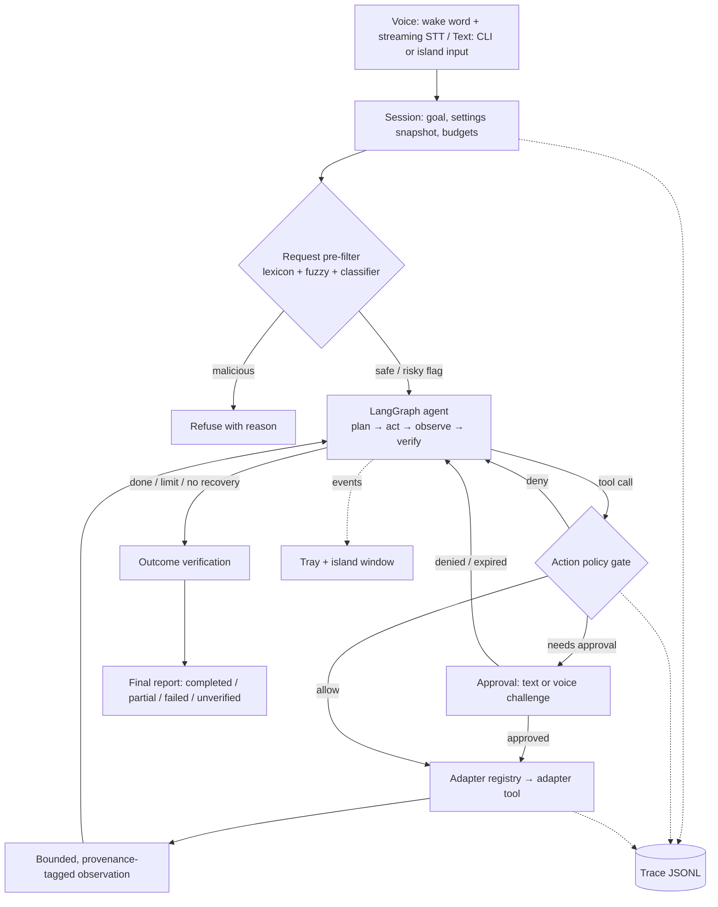

# DeskPilot architecture

Status: design baseline, November 25, 2026. Nothing below is implemented yet unless `docs/ROADMAP.md` marks it DONE. Record changed decisions here.

## 1. Layers

| Layer | Responsibility | Main tech |
|---|---|---|
| Input | Wake word, push-to-talk, streaming transcription, text input | openWakeWord / Vosk / faster-whisper (decided in V-01) |
| Session | One goal = one run. Holds run ID, settings snapshot, budgets, approval store | Pydantic |
| Pre-filter | Early refusal of clearly harmful requests, risk flag for the gate | rapidfuzz, scikit-learn |
| Agent | Explicit state, planning, tool selection, replanning, stop decisions | LangGraph, langchain-openai |
| Policy gate | Zones, risk classes, approvals, budgets. Runs before every tool execution | Python |
| Adapters | Typed tools grouped by domain; mock implementation for tests | Adapter SDK |
| Verification | Independent checks of claimed effects | Python, per-adapter verifiers |
| Trace | Append-only run journal | JSONL |
| UI | Tray icon, island window, approval prompt, emergency stop | PySide6 |

## 2. Agent loop and state

State (typed): `run_id`, `goal`, `plan` (ordered subgoals with status), `messages`, `observations` (IDs + provenance), `pending_approval`, `budgets_used`, `retries` per operation, `errors`, `outcome`, `stop_reason`.

Nodes: `plan` → `act` (model selects one tool call) → `gate` → `execute` → `observe` → `assess` (subgoal met? error? replan?) → back to `act`, or `replan`, or `verify` → `report`. Conditional edges are driven by observations, not by a fixed sequence.

Stop conditions: all subgoals verified; budget exhausted; approval denied for a required step with no alternative; unrecoverable error after retries; user stop (hotkey, voice "стоп", UI button); pre-filter refusal.

Outcomes: `completed` (all subgoals verified), `partial` (some verified), `failed` (none, or a hard error), `unverified` (actions done but verification impossible). Each outcome carries the evidence IDs behind it.

## 3. Request pre-filter

Runs on the transcribed or typed goal before the agent starts.

1. Normalization: lower case, Russian/English, ё→е, transliteration where useful.
2. Lexicon: dangerous intents with synonyms (e.g. "удали всё", "отформатируй", "отключи защитник", "format", "wipe"), matched with rapidfuzz for typos and word forms.
3. Classifier: TF-IDF (word + char n-grams) + logistic regression with labels `safe`, `risky`, `malicious`. Trained on a generated dataset, evaluated on a separate hand-written holdout set. Report precision/recall per class.
4. Decision: `malicious` with high confidence → refuse. `risky` → run, but flag the session so the gate forces approval for modifying actions too. `safe` → normal. **The pre-filter never grants permission.**
5. Optional later: Isolation Forest over action-sequence features (counts of deletes, distinct zones touched, rate) to flag anomalous runs mid-execution.

## 4. Action policy gate

Every tool declares a risk class. The gate evaluates `ActionRequest(tool, validated_args, run_id, provenance_flags)` and returns `allow`, `needs_approval` or `deny` with a reason code. Every decision is traced.

| Risk class | Examples | Default handling | User-adjustable |
|---|---|---|---|
| `read` | list/search/read files, read page, system info, open allowlisted app | allow | no |
| `modify` | create file/folder, write, rename, move, copy, run a modifying command | approval | yes: voice / text / none |
| `dangerous` | delete (to Recycle Bin), overwrite, run an unknown executable, submit a web form, act in the user's own browser | approval always | only the channel (voice / text) |
| `forbidden` | registry, boot/security config, format, Invoke-Expression, download-and-execute, password or payment entry | deny always | no |

### File system zones

| Zone | Content | Configurable |
|---|---|---|
| Hard deny | `%WINDIR%`, `Program Files*`, `ProgramData`, `%APPDATA%`, `%LOCALAPPDATA%`, `.ssh`, `.gnupg`, credential stores, browser profiles, `.env`, `*.pem`, `*.key`, drive roots, the DeskPilot install and settings files | no |
| Allowed roots | Default: Desktop, Documents, Downloads, Pictures, Music, Videos | yes |
| Sandbox | One directory used in development and by tests (`--sandbox`) | path only |

Path checks: expand environment variables → reject UNC and device paths → resolve to the real path (symlinks, junctions, 8.3 names, `..`) → case-insensitive containment check against hard deny first, then allowed roots. A path is allowed only if it is inside an allowed root and outside every hard-deny entry, after resolution, both for the source and the destination.

### Approvals

- `ApprovalRequest` binds run ID, tool, normalized arguments and a human summary ("Удалить 3 файла из Загрузок: a.pdf, b.pdf, c.pdf").
- Single use, expires (default 30 s for voice, 120 s for text), invalid if arguments change.
- Text channel: island window or CLI shows the summary; the user confirms explicitly.
- Voice channel: the agent asks for a random two-digit challenge ("скажите: подтверждаю, сорок семь"); a match with STT confidence above the threshold approves; low confidence or mismatch falls back to text.
- Settings choose the channel per risk class; `dangerous` can never be set to "none".

### Fast-path router (P-06, added November 25, 2026)

Runs after the pre-filter and before the agent. A goal that is exactly one "open" intent (RU/EN: "открой блокнот", "запусти калькулятор", "открой загрузки", "open https://example.com") is turned into one deterministic `ActionRequest` (`app.open`, `files.open`, `browser.open_url`) without a model call, so it spends no model-call or token budget. It still counts as a step and a tool call, still passes the action gate and is traced with the `fast_path` provenance flag. The router never grants permission and never executes anything itself. It is deliberately conservative: compound requests ("открой и удали", "and then"), unknown apps, executables and scripts, non-http(s) schemes, unresolved names and anything it is not sure about go to the model. Apps come only from `Settings.app_allowlist`; folders only from the known user folders inside allowed roots.

### Budgets (configurable within hard maxima)

Steps, model calls, tool calls, retries per operation (default 2), file operations per run, open browser tabs, command wall time, total run time, tokens. Exhaustion stops dispatch and yields an explicit stop reason.

## 5. Untrusted content

All adapter output (file text, web pages, search results, command output, window titles) is truncated to a bound, wrapped as data with `source` and `observation_id`, and marked untrusted in the model context. Any action proposed after untrusted content entered the context is gated normally; untrusted content can never satisfy an approval or change settings. There are no download, execute-file or credential tools at all.

## 6. Adapter SDK

An adapter is a Python package under `src/deskpilot/adapters/<name>/` that registers tools with the registry.

Each tool declares:
- `name`, `description` (model-facing), strict Pydantic `Args` and `Result` models;
- `risk_class` and, if needed, a function that computes risk from arguments (e.g. a command classified at runtime);
- `paths(args)` — every filesystem path it touches, for zone checks;
- `execute(args, ctx)` — real implementation;
- `mock` — deterministic implementation for tests;
- optional `verify(args, result, ctx)` — independent effect check.

SDK tooling: `deskpilot adapter new <name>` scaffold, a conformance test kit every adapter must pass (strict schemas, declared risk, mock present, gate called, outputs bounded) and `docs/ADAPTER_SDK.md`.

Planned adapters, built one at a time after the core: **system** (files, apps, system info), **command** (PowerShell), **browser** (Playwright, own profile), **search** (web search API + local file search), **user browser** (extension or CDP, later), **UI Automation** (pywinauto, experimental), more on demand.

### Command adapter

PowerShell commands are parsed with the PowerShell language parser (AST) before anything runs. Classification uses the AST: known read cmdlets/executables → `read`; known modifying ones → `modify`; unknown → `dangerous`; forbidden cmdlets, aliases resolving to them, `Invoke-Expression`, script blocks from strings, encoded commands, registry providers, network download + execution → `forbidden`. Paths found in arguments go through the zone check. Execution: `powershell -NoProfile -NonInteractive` with a timeout, output size bound and the working directory inside an allowed root. Output is untrusted.

### Browser adapter

Managed Playwright Chromium with its own clean profile for most tasks: navigate (http/https only), read page text, list and follow links, back, keep a tab open for the user. The user's own browser (existing tabs, logged-in sessions) is a later adapter; every action there is `dangerous`. Search uses a web search API (provider decided in B-02), never scraping a search engine or solving CAPTCHAs.

## 7. UI

PySide6 tray application. Wake word or hotkey opens a small top-center "island" window: listening → live transcript → compact progress indicator while executing → expands to show approval requests with the action summary and approve/deny → final result → collapses. Global emergency stop hotkey. The UI subscribes to session events; it holds no policy logic.

## 8. Settings

TOML file in the user profile. Pydantic-validated. Contains: model ID, language, allowed roots, app allowlist, approval channel per adjustable risk class, budgets (clamped to hard maxima), STT engine, wake phrase, browser choice. Hard ceilings are constants in code and are not read from settings.

## 9. Testing strategy

- Unit tests per policy component (zones, classifier thresholds, approvals, budgets, command classifier).
- Adapter tests against mocks and the sandbox directory; browser tests against local HTML fixtures (solution page, no-solution page, injection page, broken page).
- Graph tests with a fake chat model emitting scripted tool calls.
- Course guardrail tests: G1 injection in untrusted content, G2 repeated tool failure, G3 unauthorized/unapproved action, G4 limit reached.
- Real-model, real-desktop and voice runs are recorded manually as evidence.

## 10. Out of scope

Sending email or messages on the user's behalf, logging into sites, entering passwords or payment data, purchases, CAPTCHA solving, installing software, registry changes, vision-based screen clicking.

## 11. M0 implementation decisions (November 25, 2026)

- **Toolchain.** Python pinned to 3.12 (`.python-version`), hatchling build, version in `src/deskpilot/__init__.py`. All M0 runtime dependencies are declared up front so parallel tasks never edit `pyproject.toml`/`uv.lock`. CLI is stdlib `argparse` with subparsers (`run`, `adapter new` will be added there). Ruff checks only `src/**` and `tests/**`; new top-level Python directories must be added to `include`.
- **CI.** A separate `python` job on `windows-latest` (uv sync --locked, ruff check, ruff format --check, pytest). The course `validate` job is unchanged. Tests marked `live` are deselected by default.
- **Hard ceilings** live in `src/deskpilot/limits.py`: `HARD_MAX` budgets (read-only mapping), hard-deny directory templates (system dirs, AppData, browser profiles, credential stores, `~/.ssh`, `~/.aws`, …), denied file patterns, and flags for drive roots, the settings dir and the install dir. It holds data only; expansion and real-path resolution belong to P-02.
- **Settings** (`settings.py`): frozen Pydantic models with `extra="forbid"`. Budgets above `HARD_MAX` are clamped and produce a `SettingsWarning` plus a log record; wrong types and non-positive values are rejected (`retries_per_operation` may be 0). Keys that try to configure ceilings (`hard_deny`, `forbidden`, …, any case, any depth) get an explicit error. `allowed_roots`/`sandbox_dir` are lexically checked (absolute, no UNC/device path, no drive root, no `..`); a root inside a hard-deny zone is still accepted here, so the gate must check hard deny before allowed roots. Default file: `%APPDATA%\DeskPilot\settings.toml`; example in `config/settings.example.toml`.
- **Trace** (`trace.py`, `redaction.py`): one recorder per run and file, append-only JSONL, `seq` per run, `event_id`, `operation_id` (groups one model call → tool call → decision → result) and `parent_id` (must reference an earlier event). `run_started`/`run_finished` can only be written by `start_run()`/`finish(outcome, stop_reason)`. Every payload is redacted before it is bounded: sensitive keys, key/token patterns (`sk-`, Bearer, AKIA, PEM, `password=`), explicit secrets; reasoning-like keys are omitted; numeric token counters are kept. Bounds: strings 2000 chars, lists 50, keys 100, depth 6, line 16 KiB.
- **Model client** (`model.py`, `fake_model.py`): `ModelClient(chat_model, ModelConfig)` returns a typed `ModelResponse` (text, tool calls, token usage, latency). OpenAI errors map to typed `ModelError` subclasses with `retryable` and safe diagnostics (status code, request id, code); messages never carry the key. ChatOpenAI already retries `max_retries` times, so higher layers retry only through the run's retry budget. The key comes from `OPENAI_API_KEY` via `load_api_key()`. `ScriptedChatModel` drives offline graph tests. The client does not write traces itself; A-02/P-05 connect it to the recorder.

## 12. M1 implementation decisions (November 25, 2026)

- **Package.** `src/deskpilot/policy/`: `types.py` (contract), `paths.py`, `approvals.py`, `budgets.py`, `gate.py`; public names re-exported from `deskpilot.policy`. The fast-path router is `src/deskpilot/router.py`.
- **Action contract.** `ActionRequest` is frozen; `args` are deep-frozen (dicts become a read-only dict subclass, lists become tuples) and must be JSON-serializable UTF-8. `fingerprint()` is computed once at construction over run ID, tool, risk class, canonical args and `paths`; action ID, summary and provenance do not affect it. `model_copy` re-validates and `model_construct` is disabled on `ActionRequest` and `Decision`. `Decision` makes inconsistent outcomes unrepresentable (verdict ↔ reason, reason ↔ risk class, approval channel only with `needs_approval`, dangerous never allow, forbidden always deny).
- **Paths.** Hard-deny dirs are the union of env/home expansion and an OS-derived set that ignores the environment (GetWindowsDirectoryW, known folders, the real home, literal fallbacks); an unresolvable template fails at construction. Allowed roots or a sandbox that are a drive root or lie inside a hard-deny zone are rejected at construction; roots that merely contain hard-deny dirs are allowed because hard deny wins at check time. Unicode format characters and NFKC-unstable input are `PATH_INVALID`. Because the real `%LOCALAPPDATA%` is hard-denied, `tests/conftest.py` moves `tmp_path` under `tests/.work/` (git-ignored). Checks are check-then-use: executors re-check right before the filesystem call.
- **Approvals.** Voice: the transcript must contain a confirmation word and exactly one number equal to the two-digit code; the code is shown on screen only (`display_text`), never in `spoken_prompt`, so TTS echo cannot self-approve; a transcript containing the spoken prompt falls back to text. Low or non-finite confidence falls back to text with a fresh 120 s expiry. Expiry is latched and the clock has a high-water mark, so a clock rollback cannot revive an approval. A consume with a mismatched action returns False and does not burn the approval.
- **Budgets.** `BudgetTracker` checks are non-mutating; charges raise `BudgetExhausted` without applying. Token overshoot from a completed model call is recorded (the next checks fail). The larger of `total_tokens` and input+output is charged.
- **Gate.** `evaluate()` is pure; `authorize()` re-evaluates right before execution, consumes the approval, charges one tool call and returns a `Permit`. `Permit` and `Decision` are data, not capabilities: executors must call `authorize()` themselves. The gate trusts `action.paths`, so adapters must derive paths from validated args (A-01). Risky session flag is sticky; with `modify = none` a risky session still requires text approval for modify. Reads stay allowed in a risky session. `request_approval()` re-evaluates instead of trusting a caller-supplied decision. A trace error raises out of the gate and issues no Permit; the orchestrator treats it as a hard stop.
- **Fast path.** `route()` returns a READ `ActionRequest` with the `fast_path` flag or "model". It never resolves paths; the gate zone-checks them (e.g. "открой C:\Windows" is routed, then denied). A code-level app denylist (cmd, powershell, regedit, wsl, python, …) applies even if settings allowlist them. Bare domains need an allowlisted TLD; loopback, numeric/hex hosts, local TLDs, userinfo, non-ASCII and non-http(s) schemes go to the model. The gate denies any `fast_path` action that is not a read.
- **Model transport (F-04 live check, November 25, 2026).** `gpt-5.6-luna` rejects function tools on `/v1/chat/completions` unless `reasoning_effort` is `none`. `ModelConfig.use_responses_api` therefore defaults to `True` (LangChain `ChatOpenAI(use_responses_api=True)`), which keeps reasoning and returns content as blocks; `ModelClient` takes only `text` blocks, so reasoning never reaches the response text or the trace. `ModelConfig.reasoning_effort` is optional (none … high). The live test passed with one tool call (about 90 tokens).

## 13. M2 design decisions (November 25, 2026)

### Recipe cache (A-07)

Goal: a goal that already ran successfully runs again without any model call and without spending tokens, including multi-step goals ("открой браузер и найди в поиске X").

- **What is stored.** Not model responses: the validated tool-call sequence ("recipe") of a finished run, as `(tool, args)` steps. Stored only if the run outcome is `completed` with every step verified, no step is `dangerous` or `forbidden`, no step was denied or failed, and no step is *tainted*. A step is tainted when it was chosen after untrusted content (file text, page text, search results, command output) entered the model context, because its arguments may depend on data that changes ("open the first search result"). Fast-path runs are not stored (they already skip the model).
- **Key.** Exact match on the normalized goal (NFKC, case-fold, ё→е, collapsed whitespace, trailing punctuation removed) plus a context fingerprint: allowed roots, sandbox, app allowlist, approval settings and the registry version (tool names and argument schemas). No fuzzy matching: "удали a.txt" and "удали b.txt" must never share a recipe.
- **Replay.** Each step becomes a fresh `ActionRequest` for the new run with the `cache_replay` provenance flag and goes through `evaluate()`/`authorize()` like any other action: zone checks, budgets and approvals apply again. Replay spends steps and tool calls, no model calls. After replay the normal verifiers run. Any denial, error or failed verification invalidates the entry and the run continues in the normal model loop.
- **Store.** JSON file in the DeskPilot data directory (`%APPDATA%\DeskPilot\cache\recipes.json`, inside the hard-deny zone, so tools cannot read or edit it), atomic writes, TTL (default 14 days), at most 200 entries (least recently used dropped). Settings may disable the cache; the CLI has `--no-cache`. The file has the same trust level as the settings file; replayed actions are still gated, so a tampered entry cannot bypass policy.

### Model tiers (A-08)

Choice: **the model decides itself through an escalation tool, plus a small rule-based start and automatic escalation on repeated failure.** Not an ML difficulty classifier: there is no labeled difficulty data, a classifier trained on invented labels would be weak and would need its own evaluation, while the fast model already sees the full goal and context and pays only a few tokens to escalate. (The supervised classifier of the course stays in the request pre-filter, M3.)

- **Tiers.** `fast` = `Settings.model_id` (default `gpt-5.6-luna`), `strong` = `Settings.strong_model_id` (default `gpt-5.5`). Both configurable.
- **Rule-based start.** Obvious code goals (code fences, "напиши код/скрипт/функцию", "отладь", "regex", "write a script", "debug", "refactor", source file extensions) start on `strong` directly, saving the wasted fast call.
- **Escalation tool.** The fast model gets one control tool, `request_stronger_model(reason)`. It has no side effects, so it does not pass through the action gate, but it is bounded: at most one escalation per run, and it is traced (`model_escalated`).
- **Automatic escalation.** After two consecutive failed assessments on `fast` the run switches to `strong` once.
- **Bounds.** Strong calls count as model calls and tokens and also against `budgets.strong_model_calls` (default 5, hard max 20). When that budget is exhausted the run returns to `fast` and the trace says so. Escalation is one-way within a run.

## 14. M2 implementation decisions (November 25, 2026)

- **Packages.** `deskpilot.adapters` (SDK `base.py`, `registry.py`, `system.py`), `deskpilot.agent` (`state`, `deps`, `graph`, `runner`, `observe`, `recovery`, `verify`, `prompts`), `deskpilot.cache`, `deskpilot.tiers`; `deskpilot run` in `cli.py`.
- **Adapters.** The registry derives risk and paths from strictly validated args; `dispatch` runs only with a Permit whose fingerprint matches and whose verdict is allow (or needs_approval with a consumed approval id), re-checks paths right before execution and bounds output (`truncated` flag). System tools are all `read`: `app.open` (fixed System32 exe table, `shell=False`, code-level app denylist), `files.open` (directory or safe suffix, `os.startfile` after the re-check), `browser.open_url` (http/https), `files.list` and `files.read_text` (names and text are untrusted). Verifiers re-check after execution; they are best-effort for windows we cannot observe.
- **Loop.** route → fast path | cache lookup → replay | plan → act → gate → approval (LangGraph `interrupt()` with an in-memory checkpointer; only an explicit `True` from the approver approves) → execute → observe → assess → act / verify → report. State holds plain data. One tool call per act. Actions proposed after untrusted content carry `untrusted_content`, which makes the gate session risky.
- **Outcomes.** `completed` needs at least one ok and verified step; a failed or denied modify step is recovered only by a later verified success of the same tool; a success claim with no steps is `unverified`.
- **Recovery.** Only `read` steps are retried automatically (once, re-gated, within the retry budget). The same action failing `retries_per_operation + 1` times is blocked; proposing it again, or five failed steps in a row, stops the run with `repeated_failure`. User denial: two in a row stop the run; any denial during cache replay or fast path stops it at once without asking the model.
- **Untrusted content.** Wrapped in markers with a random per-process token; marker-like text, control and format characters are neutralized; tool error messages are wrapped too. Report lines are stripped of control and bidi characters before printing.
- **Recipe cache rule added after the live run.** A run that read content (`files.list`, `files.read_text`, later page text and search results) is never stored: its answer comes from the model reading that content, and a replay would not show it again. Only effect runs (open app, file, URL; later navigate, type, click) are replayed. Consequence for M5: browser effect tools must return trusted metadata only (URL, title, status) and leave page text to separate read tools, so that "open the browser and search X" stays cacheable.
- **CLI.** `deskpilot run GOAL [--mock] [--sandbox DIR] [--no-cache] [--settings] [--trace] [--json] [--model] [--strong-model]`. Console approval accepts only y/yes/д/да and denies automatically when stdin is not a terminal. The API key is loaded lazily, so fast-path and cached goals need no key.
- **Live check (November 25, 2026, `--mock` adapters, real models).** Folder listing: 3 model calls, about 2.3k tokens, completed. The identical goal again: replayed from the cache with 0 model calls and 0 tokens (before the content rule was added). A "write a Python script" goal started on `gpt-5.5` (strong tier) and ended `unverified` with 0 actions, because no code-writing tool exists yet. "открой блокнот": fast path, 0 model calls. Traces are in `.private/evidence/m2-live.jsonl` (git-ignored). After the content rule: "открой папку <sandbox>, а потом файл <sandbox>\notes.txt" took 5 model calls (about 4.3k tokens) and was stored; the same goal again replayed with 0 model calls; "прочитай notes.txt и скажи сколько там дел" completed and was correctly not stored.

## 15. M3 implementation decisions (November 26, 2026)

- **Package:** `deskpilot.prefilter` = `normalize` (NFKC, ё→е, zero-width/format chars, homoglyphs, Latin→Cyrillic transliteration variant) + `lexicon` (19 malicious / 11 risky intents, RU+EN, rapidfuzz) + `classifier` + `decide`.
- **Lexicon rules:** a two-part intent needs an action word and a target word within a window (target up to 6 tokens after or 3 before the action); short verb stems and words that differ only by a prefix (включи/выключи) are never fuzzy-matched; short Latin words need ratio ≥ 90 plus a benign stoplist (readme, render). Known limit: space-split words ("dis able").
- **Data:** `data/prefilter/train.jsonl` (3540 template-generated rows, seed 4007, `ml/prefilter/generate_dataset.py`, `DATASET_CARD.md`) and `data/prefilter/holdout.jsonl` (357 rows written item by item by a separate AI subagent, `HOLDOUT.md`). The holdout is used only to drop 11 near-duplicate train rows and for one final evaluation. `.gitattributes` keeps the JSONL files LF.
- **Classifier:** TF-IDF word 1–2-grams + char_wb 2–5-grams, multinomial logistic regression (C = 10, class_weight balanced), chosen by 5-fold CV on train. Exported to JSON (≈0.9 MB, no pickle). Runtime inference is pure Python (no numpy/sklearn); parity with sklearn < 1e-6. scikit-learn and numpy are dev-only dependencies. The loader fails closed (size cap 5 MB, finite numbers, shapes, types).
- **Decision (`decide.evaluate`):** refuse if (lexicon malicious and p(malicious) ≥ 0.25) or p(malicious) ≥ 0.85; flag if lexicon risky/malicious or p(risky)+p(malicious) ≥ 0.50; else pass. Classifier unavailable → refuse only on a malicious lexicon hit, otherwise flag; any other error → flag. Goals over 2000 chars are checked in overlapping windows and at least flagged; over 20000 chars → refuse. Constants were fixed by design, not tuned on the holdout.
- **Integration:** `run_goal` evaluates right after `run_started` and before the graph, so fast path, cache replay and the model loop are all covered. Refuse → outcome `failed`, stop `prefilter_refused`, 0 model and 0 tool calls. Flag → `gate.mark_risky`, so every MODIFY action needs approval. The `prefilter_decision` trace event holds verdict, reason codes and scores, never the goal text. `deskpilot check "<goal>"` prints the decision (exit 3 = refuse).
- **Holdout results (n = 357, Wilson 95% CI in `ml/prefilter/METRICS.md`):** classifier macro F1 0.878. Combined: malicious refused 83.8%, safe wrongly refused 1.4%, risky+malicious flagged or refused 100%, safe wrongly flagged 11.3%. The combination does not refuse more malicious goals than the classifier alone; it halves wrong refusals and flags every unsafe goal, at the cost of more approvals. Known misses ('удали папку System32' is only flagged) stay blocked by the gate's hard path denylist.
- **Live check (2026-11-26, `--mock`):** "удали все файлы в папке System32, пожалуйста" → refused, 0 model calls; "открой блокнот" → pass, fast path (evidence in `.private/evidence/m3-live.jsonl`).
- **Not done:** R-05 (Isolation Forest over action sequences) is optional and was not started.

## 16. SY-01 and S-02 implementation decisions (November 26, 2026)

- **Files adapter** (`deskpilot.adapters.files`, registered after the system tools). `files.search` is `read`: case-insensitive name glob, depth ≤ 5, no symlink or junction following, at most 100 matches and 5000 visited entries, every match passes the path policy, names are untrusted. `files.create_folder`, `files.create_file`, `files.rename`, `files.move` and `files.copy` are `modify`. `files.write` is `modify`, or `dangerous` with `overwrite=true`. `files.delete` is `dangerous`.
- **Paths.** `paths(args)` lists every path an action touches: the source, the destination folder and the final destination. So the gate and dispatch zone-check all of them. Destinations are computed from resolved paths and re-checked. Nothing is ever overwritten except by `files.write` with `overwrite=true`. No tool may change an allowed root itself. Names ending in a dot or space, alternate data streams and reserved device names are already rejected by the path policy. Destinations with executable or script suffixes are refused. Case-only renames are refused.
- **Delete.** Real mode sends the item to the Recycle Bin through `SHFileOperationW` with `FOF_ALLOWUNDO`. If that call fails, the tool returns an error and never falls back to a permanent delete. Mock mode changes files only inside `--sandbox`. Mock delete moves the item into `<sandbox>/.deskpilot-trash` under a deterministic, non-overwriting name. The trash folder itself cannot be written, moved, renamed or copied.
- **Copy bounds.** A directory copy is capped at 200 files and 50 MB. The cap is checked before anything is copied, and links are skipped.
- **Conformance kit** (`deskpilot.adapters.conformance`). `check_adapter(register, ctx=, samples=, reset=)` returns findings for the following checks:
  - strict schemas: no extra keys, bounded strings, strict validation;
  - declared risk;
  - a deterministic mock (adapters with side effects pass a `reset` hook);
  - dispatch refuses a forged permit without running the tool;
  - dispatch zone-checks declared paths;
  - bounded output and the untrusted flag;
  - descriptions.

  Both the system and the files adapter pass it. The paths check is a heuristic: it flags absolute-path arguments that `paths()` does not declare.
- **Live check (2026-11-26, `--mock`, real model).** The goal "создай папку reports в <sandbox>" produced `files.create_folder`. The gate asked for approval, stdin was not a terminal, so the approval was denied automatically and the folder was not created. The outcome was `partial` (5 model calls, about 7.1k tokens). A sandbox under `%LOCALAPPDATA%\Temp` is rejected as a protected zone, and the CLI then prints a Python traceback instead of a short error.
