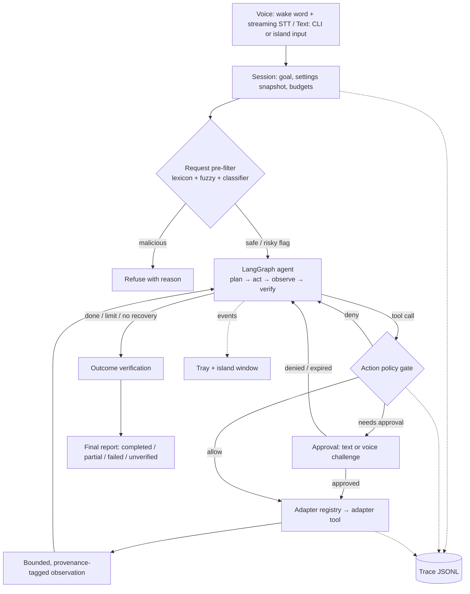

# DeskPilot architecture

Status: design baseline, November 25, 2026. Nothing below is implemented yet unless `docs/ROADMAP.md` marks it DONE. Record changed decisions here.

## 1. Layers

| Layer | Responsibility | Main tech |
|---|---|---|
| Input | Wake word, push-to-talk, streaming transcription, text input | openWakeWord / Vosk / faster-whisper (decided in V-01) |
| Session | One goal = one run. Holds run ID, settings snapshot, budgets, approval store | Pydantic |
| Pre-filter | Early refusal of clearly harmful requests, risk flag for the gate | rapidfuzz, scikit-learn |
| Agent | Explicit state, planning, tool selection, replanning, stop decisions | LangGraph, langchain-openai |
| Policy gate | Zones, risk classes, approvals, budgets. Runs before every tool execution | Python |
| Adapters | Typed tools grouped by domain; mock implementation for tests | Adapter SDK |
| Verification | Independent checks of claimed effects | Python, per-adapter verifiers |
| Trace | Append-only run journal | JSONL |
| UI | Tray icon, island window, approval prompt, emergency stop | PySide6 |

## 2. Agent loop and state

State (typed): `run_id`, `goal`, `plan` (ordered subgoals with status), `messages`, `observations` (IDs + provenance), `pending_approval`, `budgets_used`, `retries` per operation, `errors`, `outcome`, `stop_reason`.

Nodes: `plan` → `act` (model selects one tool call) → `gate` → `execute` → `observe` → `assess` (subgoal met? error? replan?) → back to `act`, or `replan`, or `verify` → `report`. Conditional edges are driven by observations, not by a fixed sequence.

Stop conditions: all subgoals verified; budget exhausted; approval denied for a required step with no alternative; unrecoverable error after retries; user stop (hotkey, voice "стоп", UI button); pre-filter refusal.

Outcomes: `completed` (all subgoals verified), `partial` (some verified), `failed` (none, or a hard error), `unverified` (actions done but verification impossible). Each outcome carries the evidence IDs behind it.

## 3. Request pre-filter

Runs on the transcribed or typed goal before the agent starts.

1. Normalization: lower case, Russian/English, ё→е, transliteration where useful.
2. Lexicon: dangerous intents with synonyms (e.g. "удали всё", "отформатируй", "отключи защитник", "format", "wipe"), matched with rapidfuzz for typos and word forms.
3. Classifier: TF-IDF (word + char n-grams) + logistic regression with labels `safe`, `risky`, `malicious`. Trained on a generated dataset, evaluated on a separate hand-written holdout set. Report precision/recall per class.
4. Decision: `malicious` with high confidence → refuse. `risky` → run, but flag the session so the gate forces approval for modifying actions too. `safe` → normal. **The pre-filter never grants permission.**
5. Optional later: Isolation Forest over action-sequence features (counts of deletes, distinct zones touched, rate) to flag anomalous runs mid-execution.

## 4. Action policy gate

Every tool declares a risk class. The gate evaluates `ActionRequest(tool, validated_args, run_id, provenance_flags)` and returns `allow`, `needs_approval` or `deny` with a reason code. Every decision is traced.

| Risk class | Examples | Default handling | User-adjustable |
|---|---|---|---|
| `read` | list/search/read files, read page, system info, open allowlisted app | allow | no |
| `modify` | create file/folder, write, rename, move, copy, run a modifying command | approval | yes: voice / text / none |
| `dangerous` | delete (to Recycle Bin), overwrite, run an unknown executable, submit a web form, act in the user's own browser | approval always | only the channel (voice / text) |
| `forbidden` | registry, boot/security config, format, Invoke-Expression, download-and-execute, password or payment entry | deny always | no |

### File system zones

| Zone | Content | Configurable |
|---|---|---|
| Hard deny | `%WINDIR%`, `Program Files*`, `ProgramData`, `%APPDATA%`, `%LOCALAPPDATA%`, `.ssh`, `.gnupg`, credential stores, browser profiles, `.env`, `*.pem`, `*.key`, drive roots, the DeskPilot install and settings files | no |
| Allowed roots | Default: Desktop, Documents, Downloads, Pictures, Music, Videos | yes |
| Sandbox | One directory used in development and by tests (`--sandbox`) | path only |

Path checks: expand environment variables → reject UNC and device paths → resolve to the real path (symlinks, junctions, 8.3 names, `..`) → case-insensitive containment check against hard deny first, then allowed roots. A path is allowed only if it is inside an allowed root and outside every hard-deny entry, after resolution, both for the source and the destination.

### Approvals

- `ApprovalRequest` binds run ID, tool, normalized arguments and a human summary ("Удалить 3 файла из Загрузок: a.pdf, b.pdf, c.pdf").
- Single use, expires (default 30 s for voice, 120 s for text), invalid if arguments change.
- Text channel: island window or CLI shows the summary; the user confirms explicitly.
- Voice channel: the agent asks for a random two-digit challenge ("скажите: подтверждаю, сорок семь"); a match with STT confidence above the threshold approves; low confidence or mismatch falls back to text.
- Settings choose the channel per risk class; `dangerous` can never be set to "none".

### Budgets (configurable within hard maxima)

Steps, model calls, tool calls, retries per operation (default 2), file operations per run, open browser tabs, command wall time, total run time, tokens. Exhaustion stops dispatch and yields an explicit stop reason.

## 5. Untrusted content

All adapter output (file text, web pages, search results, command output, window titles) is truncated to a bound, wrapped as data with `source` and `observation_id`, and marked untrusted in the model context. Any action proposed after untrusted content entered the context is gated normally; untrusted content can never satisfy an approval or change settings. There are no download, execute-file or credential tools at all.

## 6. Adapter SDK

An adapter is a Python package under `src/deskpilot/adapters/<name>/` that registers tools with the registry.

Each tool declares:
- `name`, `description` (model-facing), strict Pydantic `Args` and `Result` models;
- `risk_class` and, if needed, a function that computes risk from arguments (e.g. a command classified at runtime);
- `paths(args)` — every filesystem path it touches, for zone checks;
- `execute(args, ctx)` — real implementation;
- `mock` — deterministic implementation for tests;
- optional `verify(args, result, ctx)` — independent effect check.

SDK tooling: `deskpilot adapter new <name>` scaffold, a conformance test kit every adapter must pass (strict schemas, declared risk, mock present, gate called, outputs bounded) and `docs/ADAPTER_SDK.md`.

Planned adapters, built one at a time after the core: **system** (files, apps, system info), **command** (PowerShell), **browser** (Playwright, own profile), **search** (web search API + local file search), **user browser** (extension or CDP, later), **UI Automation** (pywinauto, experimental), more on demand.

### Command adapter

PowerShell commands are parsed with the PowerShell language parser (AST) before anything runs. Classification uses the AST: known read cmdlets/executables → `read`; known modifying ones → `modify`; unknown → `dangerous`; forbidden cmdlets, aliases resolving to them, `Invoke-Expression`, script blocks from strings, encoded commands, registry providers, network download + execution → `forbidden`. Paths found in arguments go through the zone check. Execution: `powershell -NoProfile -NonInteractive` with a timeout, output size bound and the working directory inside an allowed root. Output is untrusted.

### Browser adapter

Managed Playwright Chromium with its own clean profile for most tasks: navigate (http/https only), read page text, list and follow links, back, keep a tab open for the user. The user's own browser (existing tabs, logged-in sessions) is a later adapter; every action there is `dangerous`. Search uses a web search API (provider decided in B-02), never scraping a search engine or solving CAPTCHAs.

## 7. UI

PySide6 tray application. Wake word or hotkey opens a small top-center "island" window: listening → live transcript → compact progress indicator while executing → expands to show approval requests with the action summary and approve/deny → final result → collapses. Global emergency stop hotkey. The UI subscribes to session events; it holds no policy logic.

## 8. Settings

TOML file in the user profile. Pydantic-validated. Contains: model ID, language, allowed roots, app allowlist, approval channel per adjustable risk class, budgets (clamped to hard maxima), STT engine, wake phrase, browser choice. Hard ceilings are constants in code and are not read from settings.

## 9. Testing strategy

- Unit tests per policy component (zones, classifier thresholds, approvals, budgets, command classifier).
- Adapter tests against mocks and the sandbox directory; browser tests against local HTML fixtures (solution page, no-solution page, injection page, broken page).
- Graph tests with a fake chat model emitting scripted tool calls.
- Course guardrail tests: G1 injection in untrusted content, G2 repeated tool failure, G3 unauthorized/unapproved action, G4 limit reached.
- Real-model, real-desktop and voice runs are recorded manually as evidence.

## 10. Out of scope

Sending email or messages on the user's behalf, logging into sites, entering passwords or payment data, purchases, CAPTCHA solving, installing software, registry changes, vision-based screen clicking.

## 11. M0 implementation decisions (November 25, 2026)

- **Toolchain.** Python pinned to 3.12 (`.python-version`), hatchling build, version in `src/deskpilot/__init__.py`. All M0 runtime dependencies are declared up front so parallel tasks never edit `pyproject.toml`/`uv.lock`. CLI is stdlib `argparse` with subparsers (`run`, `adapter new` will be added there). Ruff checks only `src/**` and `tests/**`; new top-level Python directories must be added to `include`.
- **CI.** A separate `python` job on `windows-latest` (uv sync --locked, ruff check, ruff format --check, pytest). The course `validate` job is unchanged. Tests marked `live` are deselected by default.
- **Hard ceilings** live in `src/deskpilot/limits.py`: `HARD_MAX` budgets (read-only mapping), hard-deny directory templates (system dirs, AppData, browser profiles, credential stores, `~/.ssh`, `~/.aws`, …), denied file patterns, and flags for drive roots, the settings dir and the install dir. It holds data only; expansion and real-path resolution belong to P-02.
- **Settings** (`settings.py`): frozen Pydantic models with `extra="forbid"`. Budgets above `HARD_MAX` are clamped and produce a `SettingsWarning` plus a log record; wrong types and non-positive values are rejected (`retries_per_operation` may be 0). Keys that try to configure ceilings (`hard_deny`, `forbidden`, …, any case, any depth) get an explicit error. `allowed_roots`/`sandbox_dir` are lexically checked (absolute, no UNC/device path, no drive root, no `..`); a root inside a hard-deny zone is still accepted here, so the gate must check hard deny before allowed roots. Default file: `%APPDATA%\DeskPilot\settings.toml`; example in `config/settings.example.toml`.
- **Trace** (`trace.py`, `redaction.py`): one recorder per run and file, append-only JSONL, `seq` per run, `event_id`, `operation_id` (groups one model call → tool call → decision → result) and `parent_id` (must reference an earlier event). `run_started`/`run_finished` can only be written by `start_run()`/`finish(outcome, stop_reason)`. Every payload is redacted before it is bounded: sensitive keys, key/token patterns (`sk-`, Bearer, AKIA, PEM, `password=`), explicit secrets; reasoning-like keys are omitted; numeric token counters are kept. Bounds: strings 2000 chars, lists 50, keys 100, depth 6, line 16 KiB.
- **Model client** (`model.py`, `fake_model.py`): `ModelClient(chat_model, ModelConfig)` returns a typed `ModelResponse` (text, tool calls, token usage, latency). OpenAI errors map to typed `ModelError` subclasses with `retryable` and safe diagnostics (status code, request id, code); messages never carry the key. ChatOpenAI already retries `max_retries` times, so higher layers retry only through the run's retry budget. The key comes from `OPENAI_API_KEY` via `load_api_key()`. `ScriptedChatModel` drives offline graph tests. The client does not write traces itself; A-02/P-05 connect it to the recorder.
