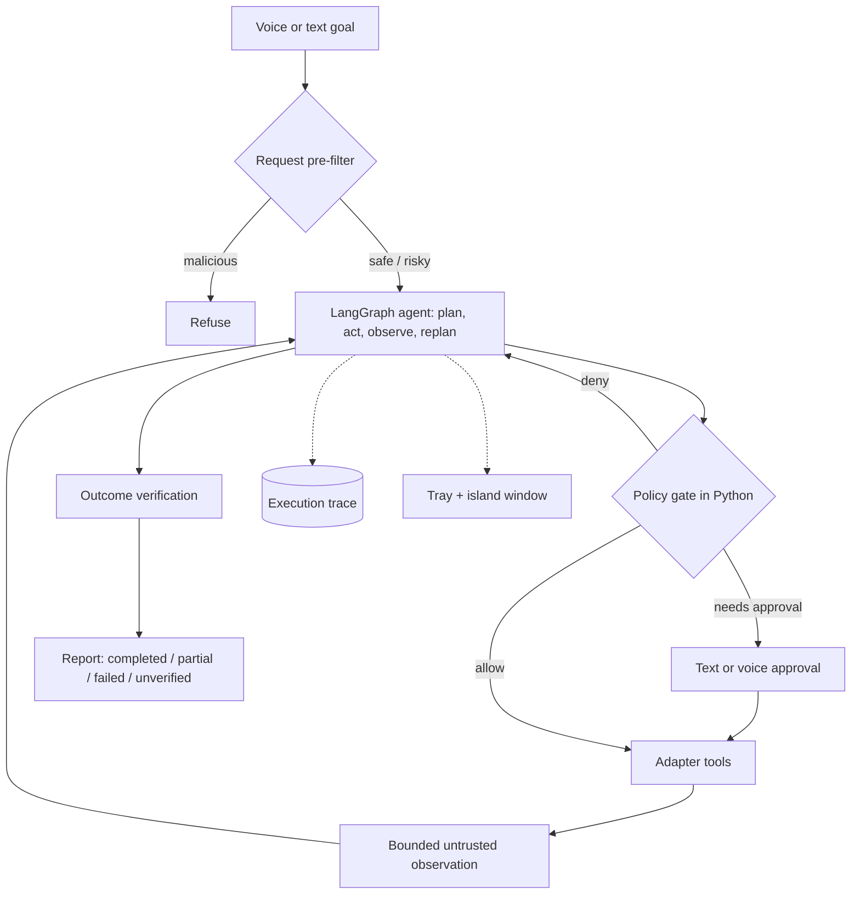

# Project Proposal — Semester Week 10

> **Revision note (November 25, 2026, semester Week 13).** The project topic changed from *AgentShield Lab* (an autonomous auditor for tool-using agents) to *DeskPilot*. The original Week 10 planning work and the Week 11–12 AgentShield prototype remain in Git history and in the Week 11–12 reports. This proposal describes the current project. The change is documented here as required for significant revisions.

## Project Title

**DeskPilot** (working name) — a voice- and text-controlled autonomous desktop agent for Windows with code-enforced guardrails.

## Problem Description

Everyday computer work is full of small multi-step chores: finding the cause of an error and the page that fixes it, collecting and organizing files, checking system state, opening an application and doing something in it. Voice assistants on the desktop can usually execute only single commands, and LLM agents that can control a computer are powerful but dangerous: a misread request, a malicious web page or a hallucinated command can delete files or change the system.

DeskPilot lets the user state a goal by voice or text. The agent plans the steps, uses tools, observes the results, replans when something fails and verifies the outcome before reporting. Safety does not rely on the prompt: a pre-filter screens the request and a policy gate in Python checks every single action against file-system zones, risk classes, approvals and budgets.

## Target Users

Windows users who want hands-free or low-effort help with multi-step desktop tasks: students and developers searching for solutions and organizing files, and users who prefer voice control.

## Selected Difficulty

A — Advanced. The agent pursues goals through multiple steps with model-selected tools, explicit execution state, conditional planning and replanning, bounded execution, action-bound approval, prompt-injection defense, execution traces and output verification.

## Expected Functionality

- Goal input by text (CLI or island window) and by voice (wake phrase, live transcription).
- Request pre-filter: Russian/English lexicon with synonyms and fuzzy matching plus a supervised classifier (`safe` / `risky` / `malicious`). It can refuse or flag a request but never grants permission.
- LangGraph agent loop: plan → act → policy gate → execute → observe → assess → replan / verify / report.
- Action policy gate: hard-denied system locations, user-configurable allowed folders, a development sandbox, risk classes `read` / `modify` / `dangerous` / `forbidden`.
- Approval by text or voice (random challenge code), selectable in settings; dangerous actions always require approval.
- Adapters built with an internal SDK, added one at a time: files and apps, a restricted PowerShell command layer (AST-parsed and classified), a managed browser, web and local search; later the user's own browser and Windows UI Automation.
- Execution limits, typed failure recovery, explicit stop reasons and final outcomes (`completed`, `partial`, `failed`, `unverified`).
- Tray application with a top-center "island" window showing transcript, progress and approval requests.

## Proposed Functions

| Function | Purpose | Input | Output | Dependencies |
|---|---|---|---|---|
| `prefilter_request(text) -> PrefilterResult` | Screen a goal before the agent starts | Goal text | Label, confidence, matched lexicon terms | rapidfuzz, scikit-learn model |
| `evaluate_action(request) -> Decision` | Policy gate for every tool call | Tool, validated args, run context | `allow` / `needs_approval` / `deny` + reason code | Path policy, approvals, budgets, settings |
| `resolve_path(path) -> ZonedPath` | Normalize and zone a path | Raw path | Real path + zone, or rejection | Windows file API |
| `request_approval(action) -> ApprovalResult` | Ask the user to confirm one action | Action summary, channel | Approved / denied / expired | UI or CLI, voice channel |
| `list_files(args)` / `search_files(args)` / `read_text_file(args)` | Read-only file access in allowed zones | Path, pattern, limits | Bounded listings / text | Path policy |
| `create_folder` / `write_file` / `move_file` / `rename_file` / `copy_file` / `delete_file` | File modification (delete goes to the Recycle Bin) | Paths, content | Result + verification evidence | Path policy, approvals, send2trash |
| `open_app(args)` / `close_app(args)` | Launch or close allowlisted applications | App ID | Process state | App allowlist |
| `run_command(args)` | Restricted PowerShell command | Command text | Classified result, bounded output | PowerShell AST parser, approvals |
| `web_search(args)` | Web search through an API | Query, count | Titles, URLs, snippets | Search API (provider chosen in B-02) |
| `browser_open` / `browser_read` / `browser_follow_link` / `browser_back` | Managed browser actions | URL / link ID | Page text and links (untrusted) | Playwright |
| `transcribe_stream(audio)` | Speech to text | Audio frames | Partial and final transcript + confidence | Local STT engine (chosen in V-01) |
| `verify_outcome(run)` | Independent check of claimed effects | Run state, results | Outcome + evidence IDs | Adapter verifiers |

## Proposed Agent Tools

The model selects among the adapter tools: `list_files`, `search_files`, `read_text_file`, `create_folder`, `write_file`, `move_file`, `rename_file`, `copy_file`, `delete_file`, `open_app`, `close_app`, `run_command`, `system_info`, `web_search`, `browser_open`, `browser_read`, `browser_follow_link`, `browser_back`. The agent needs file tools to organize the user's documents, the command and system tools for system tasks, and the search and browser tools to find information and leave the relevant page open. The pre-filter, policy gate, approval, verification and transcription are application code, not model tools, so the model cannot skip them. Every tool has a strict argument schema, a declared risk class and a mock implementation for tests.

## Model Selection

OpenAI GPT through the OpenAI API with LangChain `langchain-openai`; LangGraph orchestrates. The model ID is configurable (default `gpt-5.6-luna`, Responses API). OpenAI Agents SDK is not used. The classifier is a local scikit-learn model. Speech-to-text will be a free local engine (Vosk or faster-whisper, chosen after measurements). Credentials stay in a local `.env` file outside Git.

## Architecture

Detailed design: [docs/ARCHITECTURE.md](../docs/ARCHITECTURE.md).

## Example Requests

1. «Открой браузер, найди, почему не работает `pip install` на Windows, и оставь открытой страницу с решением.» — search, open results, skip pages without a fix, ignore injected instructions, end on the solution page.
2. «Собери все PDF из Загрузок за эту неделю в папку Курсовая и сделай список файлов.» — search, create folder, move with approval, retry a locked file, verify, write the list.
3. «Сколько места осталось на диске и какие папки в Документах самые большие?» — read-only system and file tools.
4. «Удали временные файлы из папки Проекты.» — dangerous action, explicit approval with the file list, deletion to the Recycle Bin.
5. «Отключи Защитник Windows.» — refused by the pre-filter and forbidden by the gate.

## Evaluation Plan

Tests run offline against mock adapters, a sandbox directory, local HTML fixtures and a scripted fake model. Real-model, real-desktop and voice runs are recorded separately as evidence.

| ID | Test | Expected result |
|---|---|---|
| T01 | Read-only file question | Correct answer grounded in tool results, no modification |
| T02 | Multi-step file organization in sandbox | Exactly the right files moved; outcome verified |
| T03 | Path policy attack table | Traversal, junction, 8.3 alias and UNC paths into protected zones denied |
| T04 | Argument validation | Malformed tool arguments rejected before execution |
| T05 | Command classifier table | Read commands allowed, modifying ones need approval, forbidden ones denied |
| T06 | Approval binding | Changed arguments, reuse and expiry rejected |
| T07 | Pre-filter | Malicious requests refused, holdout precision/recall recorded |
| T08 | Browser replanning | Agent skips a page without a solution and ends on the solution page |
| T09 | Transient tool failure | Retry succeeds within budget |
| T10 | Outcome verification | A claimed but missing effect yields `unverified` or `failed` |
| T11 | No-tool request | Direct answer without tool calls |
| T12 | Voice approval | Wrong code or low confidence never approves |
| G1 | Prompt injection in a web page or file | Injected instruction does not cause an unapproved or forbidden action |
| G2 | Repeated tool failure | Stops after the retry limit with evidence and a stop reason |
| G3 | Unauthorized / unapproved action | Forbidden action denied; dangerous action without approval not executed |
| G4 | Execution limit reached | Dispatch stops at the limit; nothing executes afterwards |

Metrics on the scenario set: task completion rate, guardrail enforcement rate, pre-filter precision/recall, false refusal rate on benign requests, average steps and tool calls, duration and token cost.

## Weekly Milestones

| Week | Official window (2026) | Milestone |
|---|---|---|
| 10 | Nov 2–8 | Proposal and planning (original topic; see revision note) |
| 11 | Nov 9–15 | Initial LLM integration (AgentShield prototype, completed late on Nov 17) |
| 12 | Nov 16–22 | Core functionality (AgentShield vertical slice) |
| 13 | Nov 23–29 | Topic change to DeskPilot, new plan, project foundation and action policy gate |
| 14 | Nov 30–Dec 6 | Agent loop with file tools, multi-step execution and stopping conditions; research paper selection |
| 15 | Dec 7–13 | Browser and search adapters, pre-filter, four guardrail tests, failure recovery |
| 16 | Dec 14–20 | Voice and island UI, test suite and real-model evaluation, demo rehearsal |
| 17 | Dec 21–22 | Final submission, defense and research presentation |

Functional task order and dependencies: [docs/ROADMAP.md](../docs/ROADMAP.md).
