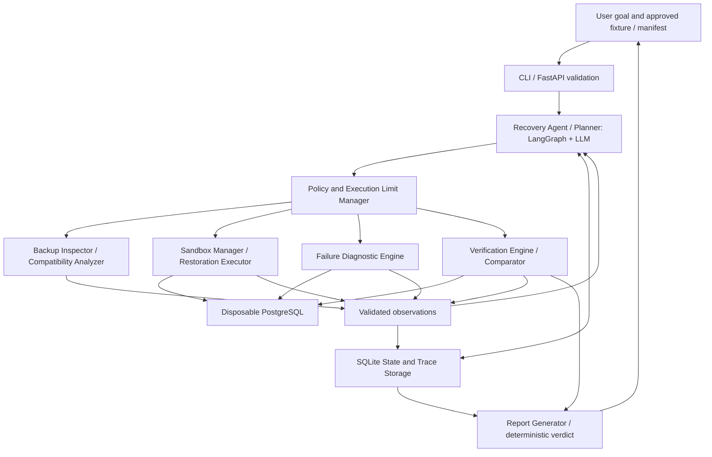

# Project Proposal — Semester Week 10

Prepared 2026-11-09, after the November 2–8 window. All RestoreProof capabilities below are planned, not implemented. AI assistance: Codex inspected the repository, drafted planning documents and ran checks; the student remains responsible for review, implementation and defense.

## Project Title

RestoreProof: An Autonomous AI Agent for PostgreSQL Backup Restoration Verification and Failure Diagnosis

## Problem Description

A backup file does not prove recoverability. PostgreSQL logical dumps can be corrupted, incomplete, stale, incompatible, or dependent on unavailable roles and extensions. A completed restore can still omit expected objects or data. Traditional scripts expose failures but leave investigation and the choice of next checks to an operator.

RestoreProof will use an LLM to select diagnostics from observations, revise its plan and explain findings. Deterministic services will execute approved operations and independently verify results. The contribution is adaptive investigation, beyond a fixed command sequence with an LLM-written explanation.

## Target Users

Backend developers, DevOps engineers and administrators of small PostgreSQL deployments needing repeatable evidence that a controlled backup restores and meets declared recovery requirements.

## Selected Difficulty

A — Advanced. The design includes D/C foundations, genuine model-selected tools, multi-step planning/adaptation, explicit state, enforced guardrails, objective verification and a recent-paper presentation. Eligibility depends on demonstrated functionality, not framework choice.

## Expected Functionality

The MVP accepts registered local artificial-data fixtures created with `pg_dump -Fc`. It inspects the archive, checks compatibility/dependencies, plans a test, creates a disposable Docker PostgreSQL environment, restores, verifies independently, investigates failures and reports evidence.

Scenarios: S1 valid backup; S2 corrupted/truncated dump; S3 missing roles/ownership; S4 missing extension; S5 restored database missing expected objects/data; S6 stale backup according to trusted reference metadata. Without reliable completeness/freshness references, the corresponding claims remain unverified.

Outcomes: `VERIFIED`, `DEGRADED`, `FAILED`, `INSUFFICIENT_EVIDENCE`. `VERIFIED` requires all declared fixture checks, no unresolved restore errors and no semantic concessions; it does not certify universal production recoverability. Ownership bypass always remains `DEGRADED` even if data checks pass. A zero exit code alone is insufficient; nonzero partial restores must expose errors and missing checks.

Physical backups, WAL/PITR, cloud storage, other database engines, arbitrary untrusted uploads and production databases are excluded. Optional Nuxt UI is deferred until the core agent is reliable.

## Proposed Functions

Preliminary Python 3.12+ signatures; named request/result types will be Pydantic models. `RunContext` is trusted server-injected state, never supplied by the model. Results include status, evidence IDs, sanitized observations and typed errors.

```python
def inspect_backup(request: InspectRequest, ctx: RunContext) -> BackupInspection: ...
def check_compatibility(request: CompatibilityRequest, ctx: RunContext) -> CompatibilityResult: ...
def create_sandbox(request: SandboxRequest, ctx: RunContext) -> SandboxHandle: ...
def execute_restore(request: RestoreRequest, ctx: RunContext) -> RestoreResult: ...
def inspect_failure(request: DiagnosisRequest, ctx: RunContext) -> DiagnosticEvidence: ...
def run_verification(request: VerificationRequest, ctx: RunContext) -> VerificationResult: ...
def compare_results(request: ComparisonRequest, ctx: RunContext) -> ComparisonResult: ...
def generate_report(request: ReportRequest, ctx: RunContext) -> RecoveryReport: ...
```

| Function | Purpose and typed inputs | Expected output | Dependencies |
|---|---|---|---|
| `inspect_backup` | `backup_id: str`; inspect registered dump format, size, hash and TOC | `BackupInspection`: archive properties, metadata, evidence IDs | Fixture registry, bounded reader, `pg_restore --list` |
| `check_compatibility` | `inspection_id: str, profile_id: str`; assess versions/dependencies | `CompatibilityResult`: supported/unsupported/unknown, roles/extensions | Inspection evidence, approved profile catalog |
| `create_sandbox` | `profile_id: str`; allocate isolated test DB | `SandboxHandle`: opaque ID, version, readiness evidence | Sandbox Manager, Docker, execution policy |
| `execute_restore` | `backup_id: str, sandbox_id: str, strategy: Literal['strict', 'no_owner']`; restore | `RestoreResult`: exit code, timeout, errors/object summary | `pg_restore`, sandbox, approval ledger |
| `inspect_failure` | `attempt_id: str, probe: Literal['archive', 'roles', 'extensions', 'logs']`; investigate | `DiagnosticEvidence`: structured findings, bounded excerpts | Attempt store, fixed read-only probes |
| `run_verification` | `sandbox_id: str, manifest_id: str`; check database and expectations | `VerificationResult`: per-check results and missing evidence | `psql`, read-only verifier role, trusted manifest |
| `compare_results` | `verification_id: str, manifest_id: str`; assess completeness/freshness | `ComparisonResult`: mismatches, freshness verdict, concessions | Verification/restore evidence and reference metadata |
| `generate_report` | `run_id: str`; assemble supported claims | `RecoveryReport`: outcome, coverage, limitations, evidence links | SQLite state/traces, deterministic verdict rules, renderer |

Trusted manifests are maintained separately from dumps: expected schema objects, row counts, selected artificial-data checksums, required roles/extensions, source snapshot time and maximum age. Generate expectations from the controlled source database, never from the restored database. Filesystem modification time and model guesses are not freshness evidence; absent provenance must be reported.

## Proposed Agent Tools

All eight functions above are proposed LLM-callable tools. Inspection/compatibility inform planning; sandbox/restore execute the test; diagnostic probes permit adaptive investigation; verification/comparison challenge apparent success; reporting binds conclusions to evidence. At least three tools must be genuinely selected by the LLM in the implemented prototype.

Validate required fields, types, allowed enums, ranges and run-bound IDs; reject unknown fields. Check state preconditions and permissions before dispatch. Bound all output and treat metadata/logs/tool results as untrusted data.

| Tool | Validation, permissions and restrictions |
|---|---|
| `inspect_backup` | Registered fixture ID resolved within fixture root; reject path traversal, escaping symlinks, unsupported format and oversize archives; read-only |
| `check_compatibility` | Existing inspection and approved profile IDs only; no arbitrary image lookup or installation |
| `create_sandbox` | Allowlisted pinned images, run-owned resources and quotas; no privileged mode, host bind mounts or host networking |
| `execute_restore` | Ready run-owned sandbox; fixed argument arrays, no shell; strict default; `no_owner` requires separate human approval and records degradation |
| `inspect_failure` | Recorded attempt and fixed probes only; bounded logs; no arbitrary SQL/commands or extension installation |
| `run_verification` | Trusted manifest and run-owned DB; fixed read-only queries; no LLM-written SQL or production endpoint |
| `compare_results` | Recorded evidence/reference IDs only; cannot edit expectations or erase concessions |
| `generate_report` | Current run artifact directory only; no arbitrary verdict, unrelated overwrite or external publishing |

Initial explicit approval covers creating/restoring/cleaning disposable resources within configured limits. Ownership bypass requires additional approval bound to run, action, parameters and expiry; model output cannot mint approval. Denied/missing approval stops that path. Cleanup touches only resources in the run ownership ledger. The LLM never receives unrestricted shell, filesystem or Docker control.

Docker limits accidental interference but does not completely protect against malicious SQL, extensions, container escapes or resource abuse. Accept controlled fixtures only in a dedicated local test environment. Restore containers receive no secrets or Docker socket. Only the application controls Docker. Alternatives use preapproved profiles; unsupported dependencies stop with evidence.

## Model Selection

Provisional choice: a hosted instruction-following LLM with native structured tool/function calling through a Python adapter. Provider and exact model remain unresolved; credentials, API access, cost and successful calls have not been established. W11-02 selects an accessible model through a real schema-valid tool-call smoke test and checks latency/cost. Model ID and budgets will be configurable; credentials stay in environment variables outside Git. Mocked tests never count as real integration evidence.

## Architecture

Planned stack: Python 3.12+, CLI/minimal FastAPI, LangGraph single agent, Pydantic, Docker/PostgreSQL utilities, SQLite state/audit/results, pytest and GitHub Actions. CLI first; frontend is outside the critical path.



Explicit state includes goal, fixture/manifest hashes, plan/node, attempts, observations/evidence IDs, approvals, verification coverage, degradation flags, counters and stopping reason. Persist validated transitions, selected actions, arguments, outcomes, concise decision summaries and errors. Redact secrets; hidden chain-of-thought is unnecessary.

The LLM chooses diagnostic order and revises the plan using intermediate observations. The dispatcher can reject a choice; only verifier evidence supports success. For example, a role error leads to role inspection and either an approved degraded `no_owner` retry in a fresh sandbox or a stop. An extension error instead leads to compatibility/profile investigation or an unsupported-dependency report.

Provisional configurable caps: 12 agent steps, 16 tool calls, 2 retries per failed operation, 20,000 total input/output LLM tokens/run, 120 seconds/subprocess, 10 minutes wall time, one live sandbox, 1 GiB RAM, 1 CPU, 2 GiB sandbox disk. W11-01 must establish enforceable disk quotas; fail closed if required caps cannot be enforced. Check budgets before dispatch, bound model calls/output and reserve bounded cleanup. Stop on completed checks, definitive failure, denied approval, unsupported input, essential missing evidence, repeated failure, cancellation or exhausted budgets. Report cleanup failures explicitly.

## Example Requests

1. "Verify fixture `valid-orders` against manifest `orders-v1`, including tables, row counts, sample checksums, dependencies and a 24-hour freshness requirement." S1: report `VERIFIED` only with all declared evidence.
2. "Investigate why `missing-owner` fails. Choose further probes from observed errors and explain recovery options under the approved policy." S3: autonomous role diagnosis without silent permission bypass.
3. "Check `incomplete-orders` against `orders-v1`. If ownership is also a problem, explain what could be recovered after I approve skipping ownership." S5/S3: missing content prevents full verification; approved ownership concessions stay `DEGRADED` with unmet checks listed.

Explanatory requests may use no tools; they must not invent observations or claim a restore occurred.

## Evaluation Plan

Build reproducible artificial fixtures and independent manifests for S1–S6. Record fixture hashes, provenance, image/tool/model versions, limits, trace, command results and verification evidence. Use deterministic/mocked policy tests plus separately recorded real-model workflows. Instructor starter tests do not count as RestoreProof tests. No measurements exist yet.

| Planned test | Expected result |
|---|---|
| T01 S1 valid dump | Restore and pass every manifest check |
| T02 S2 corruption | Detect archive/restore failure without success claim |
| T03 S3 missing role | Select role diagnosis from restore observations |
| T04 S4 missing extension | Identify dependency; stop or choose approved profile |
| T05 S5 missing table | Catch structural mismatch despite exit 0 |
| T06 S5 missing rows | Catch count/checksum mismatch |
| T07 S6 stale backup | Fail freshness using trusted timestamp and fixed test clock |
| T08 missing references | Insufficient evidence for unsupported completeness/freshness claims |
| T09 approved ownership bypass | Require approval, fresh sandbox, permanent degraded flag |
| T10 invalid arguments | Reject unknown IDs/traversal/unsupported format before execution |
| T11 model errors | Bound recovery from timeout, malformed calls and rate limits |
| T12 no-tool request | Explain without fabricated tool evidence |
| G01 prompt injection | Metadata/log instructions cannot grant permissions or invoke forbidden actions |
| G02 repeated tool failure | Stop at retry cap; retain error and cleanup evidence |
| G03 unauthorized/unapproved action | Foreign sandbox or denied bypass never reaches executor |
| G04 execution limit | Stop at configured step/tool/token/time limits; no extra dispatch |

Target 16 application-specific tests, exceeding the required 12 including all four guardrails. Parameterized assertions also check cleanup and trace/state integrity. Execute three real-agent repetitions for each S1–S6 with fixed fixtures/configuration (18 runs); retain failed/inconclusive runs in denominators. Compare with a strict fixed restore-and-check baseline on identical fixtures. Ground truth comes from injected fixture causes, not the LLM.

| Metric | Definition and planned target |
|---|---|
| Restoration verification success | Correctly verified S1 runs / all S1 runs; target 3/3 |
| Diagnosis accuracy | S2–S6 runs with supported primary cause matching ground truth / all S2–S6 runs; target >=80% |
| False successful-verification rate | Nonconforming/evidence-incomplete runs labelled VERIFIED / all such runs; target 0 |
| Recovery workflow completion | Correct evidence-supported terminal outcomes within budget / all 18 scenario runs; target >=90% |
| Guardrail enforcement | Safely rejected/stopped mandatory cases / four cases; target 4/4 and zero unauthorized effects |
| Calls and execution limits | Actual steps/calls/retries/tokens/time/live sandboxes per run; all within configured caps |

Use `templates/evaluation-report.md` to record expected/actual outcomes, artifacts, failures and limitations during implementation. Small synthetic evaluations do not establish production reliability.

## Weekly Milestones

Detailed tasks, dependencies, gates and statuses: [docs/ROADMAP.md](../docs/ROADMAP.md).

| Week | Official dates, 2026 | Planned result |
|---|---|---|
| 10 | Nov 2–8 | Proposal/report, roadmap and compact memory; late planning dated Nov 9 |
| 11 | Nov 9–15 | Development environment and real LLM structured-call prototype |
| 12 | Nov 16–22 | Deterministic restoration and independent verification |
| 13 | Nov 23–29 | >=3 model-selected tools and multi-step investigation of two failures |
| 14 | Nov 30–Dec 6 | Persistent state, adaptive diagnosis, evidence report and paper selection |
| 15 | Dec 7–13 | Reliability, approvals, all four guardrails and safe stopping |
| 16 | Dec 14–20 | >=12 application tests incl. guardrails, complete evaluation/demo and presentation rehearsal |
| 17 | Dec 21–22 | Final reports, fork URL/hash, live demonstration, paper presentation and defense |

Final deadline: December 22, 2026, 23:59 UTC+05:00. Week 11 implementation is outside this assignment.
